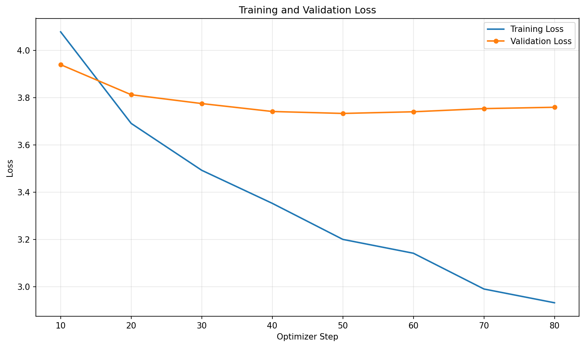

# 土味情話多輪對話助手

使用 Qwen2.5-0.5B-Instruct 搭配 QLoRA 微調，建立能提供土味情話、接續追問及調整語氣的繁體中文對話助手。

## 基礎模型與微調方式

- 基礎模型：[Qwen/Qwen2.5-0.5B-Instruct](https://huggingface.co/Qwen/Qwen2.5-0.5B-Instruct)。
- 微調方式：bitsandbytes 4-bit NF4 量化與 LoRA。
- 訓練工具：Transformers、PEFT、TRL SFTTrainer。
- 模型輸出為 LoRA adapter，推論時仍需載入基礎模型，並非獨立的完整模型。

## 訓練資料

語料由 AI 輔助生成，並經人工檢查與修正，整理為繁體中文多輪對話。內容涵蓋日常邀約、早晚安、興趣、情話接龍、語氣調整與尊重拒絕等情境，並非使用範例中的咖啡點餐資料集。

| 項目 | 數量 |
| --- | ---: |
| 完整對話 | 100 段 |
| 訓練對話 | 90 段 |
| 驗證對話 | 10 段 |
| 訓練 SFT 樣本 | 302 筆 |
| 驗證 SFT 樣本 | 35 筆 |

每段包含 system 訊息與多組 user、assistant。先以完整對話切分訓練集與驗證集，再將各次助理回答展開為 prompt、completion 樣本，避免同一段對話跨越兩個集合。驗證比例為 10%，切分亂數種子為 42。

`data/chat.jsonl` 為整合後的正式語料；`batch02.jsonl`、`batch03.jsonl`、`batch04.jsonl` 是製作過程的分批資料，不需要再次合併。

## 角色設定

```text
你是一位土味情話高手，使用自然、親切、帶幽默感的台灣繁體中文回應。你會根據使用者的情境提供簡短情話，並接續前文回答追問。對方若表示拒絕或不舒服，請尊重對方，改用不施壓的回應。
```

## 訓練環境

使用 Google Colab，GPU 為 NVIDIA Tesla T4，Python 為 3.13.15。

已確認的訓練環境套件版本：

```text
torch==2.11.0+cu130
transformers==5.17.0
trl==1.13.0
peft==0.21.0
bitsandbytes==0.50.2
datasets==5.0.1
accelerate==1.15.0
```

Matplotlib 用於曲線繪製，安裝需求列於 `requirements-colab.txt`。上述 PyTorch 版本是 Colab 環境紀錄，本機安裝需依作業系統、Python 版本及 GPU 條件調整。

## 訓練參數

| 參數 | 設定 |
| --- | --- |
| 最大序列長度 | 768 tokens |
| Epochs 上限 | 5 |
| Learning rate | 1e-4 |
| 每裝置訓練 batch size | 8 |
| 每裝置驗證 batch size | 16 |
| 梯度累積步數 | 2 |
| 驗證與儲存頻率 | 每 10 個參數更新步數 |
| LoRA rank | 8 |
| LoRA alpha | 16 |
| LoRA dropout | 0.05 |
| LoRA target modules | all-linear |
| 最佳模型依據 | 最低驗證 Loss |

單 GPU 有效訓練批量通常為 8 × 2 = 16。啟用 Early Stopping，驗證損失連續三次未改善時提前停止。

## 執行方法

### Colab 環境

將專案放在 `/content/nlp_homework2`。目前訓練、多輪推論及繪圖程式使用此 Colab 路徑；若放到其他位置，需先修改對應路徑。

在 Notebook 安裝：

```python
%pip install -r /content/nlp_homework2/requirements-colab.txt
```

安裝後重新啟動核心。如果出現 TorchAO 版本與 PEFT 不相容的錯誤，本專案使用 bitsandbytes 而非 TorchAO，可移除衝突套件：

```python
%pip uninstall -y torchao
```

### 準備資料與訓練

已提供正式語料，不需執行下載咖啡點餐資料的 `download_chat_data.py`，以免覆蓋語料。

在 Colab 終端機依序執行：

```bash
python /content/nlp_homework2/prepare_chat_data.py
python /content/nlp_homework2/train_qlora.py
python /content/nlp_homework2/plot_loss.py
```

若只使用已提供的 adapter 進行對話，不需要重新訓練。

### 多輪互動

在 Colab 終端機執行，方便透過互動輸入持續對話：

```bash
python /content/nlp_homework2/infer_lora_chat.py
```

程式載入基礎模型、`outputs/love_lora/` 中的 adapter 與 Tokenizer。第一次執行可能需要下載基礎模型。

- `/reset`：清除對話歷史。
- `/history`：查看對話歷史。
- `/help`：查看指令。
- `exit`、`quit` 或 `q`：離開。

最終展示設定為 `DO_SAMPLE = False`，關閉隨機抽樣以提高回答穩定性。這不會改變模型權重，也不保證所有回答正確。

### 本機執行注意事項

目前程式仍含 `/content/nlp_homework2/...` 的 Colab 絕對路徑。本機使用前需調整 `DATA_DIR`、`OUTPUT_DIR`、`ADAPTER_DIR` 等設定，並安裝適合本機硬體的套件。

`infer_lora.py` 仍保留原範例的咖啡點餐設定；本作業的正式展示入口為已調整角色設定的 `infer_lora_chat.py`。

## 訓練結果

| 項目 | 結果 |
| --- | --- |
| 最佳 checkpoint | checkpoint-50 |
| 最佳驗證 Loss | 3.7329 |
| 訓練停止步數 | 80 |

訓練結束後載回最佳 checkpoint，並將最佳 adapter 與 Tokenizer 儲存至 `outputs/love_lora/` 最外層。驗證集參與模型選擇，以上結果不是獨立測試集的成績；Loss 也不是對話正確率。

## 多輪對話成果

以下為實際模型輸出，保留原始內容，未人工改寫回答。

```text
你：我想用咖啡當開場，幫我想一句情話。
助理：咖啡香，心情也變好，今天遇到你，我好像又找到了一個可以聊到天黑的人。

你：如果她說她只喝無糖的呢？
助理：那就改成：咖啡香，心情也變好，今天遇到你，我好像又找到了一個可以聊到天黑的人，但這杯咖啡還是沒有加糖。
```

清除歷史後，另測試未直接出現在語料中的夜市場景：

```text
你：我想約喜歡的人去逛夜市，給我一句可以直接傳給他的土味情話。
助理：可以說：夜市裡有好多好吃的，還有人聊天，還有人唱歌，真的好想跟妳一起走一趟。

你：他說只想買地瓜球，幫我接一句跟地瓜球有關的情話。
助理：那就說：地瓜球好吃到能讓妳心跳加速，而且還會被附近的人們點餐。
```

第一組的開場問題曾出現在訓練語料中，屬於已見情境；第二組用於觀察新情境的表現。以上為質性示範，不能視為完整的泛化能力評估。

## 訓練曲線



## 限制與觀察

- 模型能生成繁體中文回覆並接續追問，但土味情話風格仍不穩定。
- 部分回答會重複前文，或出現語意不自然的內容，例如夜市測試中的「被附近的人們點餐」。
- 目前只有 100 段語料與 10 段驗證對話，資料規模及多樣性有限。
- 關閉抽樣後，本次觀察到回答較穩定，但不能修正模型本身的理解或推理錯誤。

## 檔案用途

| 路徑 | 用途 |
| --- | --- |
| `data/chat.jsonl` | 正式多輪語料 |
| `data/sft/` | 展開後的訓練與驗證樣本 |
| `prepare_chat_data.py` | 對話切分與樣本整理 |
| `train_qlora.py` | QLoRA 訓練 |
| `infer_lora_chat.py` | 正式多輪互動入口 |
| `plot_loss.py` | 訓練曲線繪製 |
| `requirements-colab.txt` | Colab 套件安裝需求 |
| `outputs/love_lora/` | 最佳 adapter、Tokenizer、訓練紀錄與曲線 |

`checkpoint-*` 用於續訓與訓練過程備份。僅供推論時，可保留模型輸出資料夾最外層的 adapter、設定、Tokenizer 與對話模板，不需附上所有 checkpoint。